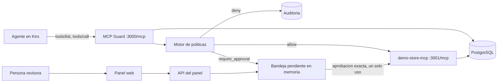

# Diseno: MCP Guard

## Arquitectura

Componentes: Guard (Fastify, endpoint MCP, API del panel, SSE), motor de politicas (modulo puro),
gestor de aprobaciones (maquina de estados, mapa en memoria), auditoria (redaccion y eventos),
upstream demo, dashboard React + Vite, PostgreSQL con Prisma.

## Flujos

- **Permitir**: validar nombre y args, regla allow, registrar decision, llamar al upstream, devolver resultado, registrar `executed`.
- **Aprobacion**: regla require_approval, hash de `{upstream, tool, args}`, crear pendiente (ID, caducidad, vista previa saneada), responder `pending_approval` con `requestId` sin llamar al upstream. Al aprobar: comprobar pendiente, no expirada, hash igual; consumir atomicamente; ejecutar una vez; registrar aprobador y resultado.
- **Bloqueo**: sin llamar al upstream, registrar regla y motivo, responder que no se ejecuto.

## Maquina de estados de ActionRequest

`requested -> blocked` | `requested -> pending -> approved -> executed | failed` |
`pending -> rejected` | `pending -> expired`. `allow` pasa `requested -> executed | failed`.
Estados terminales no admiten transiciones. Reinicio: `pending -> expired`.

## Modelo de datos

- `PolicyRule(id, name, upstreamName, toolName, effect, conditionsJson, reason, safePreviewFields, enabled, createdAt, updatedAt)`
- `ActionRequest(id, publicToolName, upstreamName, upstreamToolName, argumentHash, redactedPreviewJson, decision, status, ruleId, reason, requestedAt, expiresAt, decidedAt, executedAt, approvedBy, resultSummary, errorCode)`. Sin columna de args en claro.
- `AuditEvent(id, actionRequestId, eventType, actor, detailsJson, createdAt)`
- Tienda: `DemoOrder(id, customerName, status, currency, totalCents)`, `DemoRefund(id, orderId, amountCents, reason, status, createdAt)`, `DemoEmail(id, orderId, subject, body, status, createdAt)`.

## API del panel

| Metodo y ruta                 | Funcion                            |
| ----------------------------- | ---------------------------------- |
| GET /api/health               | Estado de Guard y tienda           |
| POST /api/session             | Iniciar sesion de revisor demo     |
| DELETE /api/session           | Cerrar sesion                      |
| GET /api/pending              | Pendientes                         |
| GET /api/actions/:id          | Detalle de accion                  |
| POST /api/actions/:id/approve | Aprobar (sesion, Origin, atomico)  |
| POST /api/actions/:id/deny    | Rechazar                           |
| GET /api/audit                | Historial con filtros              |
| GET /api/policy               | Politica en solo lectura           |
| GET /api/events               | SSE                                |
| POST /api/demo/reset          | Restaurar semilla (solo modo demo) |

## Resumen del modelo de amenazas

| Amenaza                              | Mitigacion                                                       |
| ------------------------------------ | ---------------------------------------------------------------- |
| El agente se autoaprueba             | No hay herramienta MCP approve; el panel exige sesion y Origin   |
| Cambiar args tras la aprobacion      | Hash SHA-256 del JSON canonico; llamada guardada inmutable       |
| Replay o doble clic                  | Consumo atomico de un solo uso; estado terminal                  |
| Inyeccion en descripciones de tools  | Descripciones tratadas como datos; mapa de nombres propio        |
| Fuga de secretos                     | Redaccion por clave, lista segura de campos, payload solo en RAM |
| CSRF o DNS rebinding contra el panel | Validar Origin y Host, SameSite=Strict, loopback                 |
| Bypass llamando al upstream directo  | Limite de confianza documentado; el agente solo conoce Guard     |
| Regla invalida o ausente             | Fail-closed, defecto deny                                        |
| Reinicio con pendientes              | Expiran, nunca se ejecutan solas                                 |

Detalle ampliado en `docs/threat-model.md`.

## Decisiones tecnicas

- **Motor puro y sin dependencias**: testeable con `node --test` en el sandbox sin registro npm.
- **Payload pendiente solo en memoria**: reduce datos sensibles en la base a costa de perder pendientes al reiniciar (aceptado, expiran).
- **JSON canonico propio**: claves ordenadas, sin floats para montos, hash estable.
- **SSE sobre WebSocket**: unidireccional, mas simple, reconexion nativa.
- **Streamable HTTP** para Guard y upstream con el SDK oficial MCP TypeScript.
- **Limites del sandbox de desarrollo**: sin acceso al registro npm, Docker ni PostgreSQL. Por eso `package-lock.json` y `prisma/migrations/*/migration.sql` no se generan automaticamente; la migracion se escribe a mano y el lockfile lo produce `npm install` con red. El codigo que usa fastify, zod, Prisma, el SDK MCP y React no se compila en ese sandbox y se reporta como no verificado.
